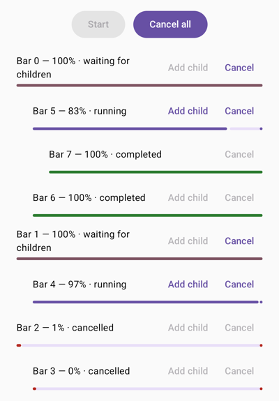
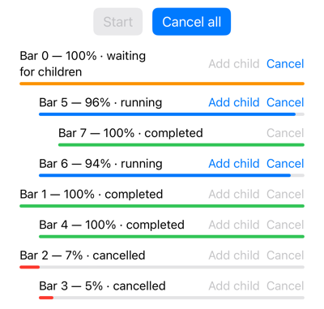

# Kotlin Coroutines / iOS Interop

A Kotlin Multiplatform showcase that makes coroutine behaviour visible. Structured concurrency,
cancellation and error propagation drive real UI (progress bars, live task state, cancel buttons)
running natively on Android and iOS.

[SKIE](https://touchlab.co/skie) bridges to Swift, turning `StateFlow` into `AsyncSequence` and
`suspend` functions into `async`, so the iOS side reads as ordinary Swift concurrency.

## What it shows

Each bar is a coroutine. Start launches three top-level bars; any bar can launch children, up to
three levels deep, and can be cancelled on its own.

- **Cancellation travels down, never up.** Cancelling a bar stops its subtree; its parent and
  siblings keep running.
- **A parent waits for its children.** A bar at 100% with running children shows *waiting for
  children* until they finish.
- **Nothing new joins a finished job.** Waiting, completed and cancelled bars can't add children.

| Android (Compose) | iOS (SwiftUI) |
|---|---|
|  |  |

## Structure

```
shared/       # KMP library — all business logic
composeApp/   # Android app (Jetpack Compose)
iosApp/       # iOS app (SwiftUI, Xcode project)
```

`shared` produces the `Shared` framework consumed by Xcode. Both UI layers are thin: they observe
state and call functions on shared classes.

## Architectural choices

Some choices favour the demonstration over production convenience, because the conventional option
would hide the thing being shown.

### Native UI on each platform, not Compose Multiplatform

Rendering Compose on iOS would remove the language boundary, and with it the interop being
demonstrated. Android uses Compose, iOS uses SwiftUI, and `shared` exposes no UI. That's why
`App.kt` lives in `composeApp/androidMain` and `composeApp` has only an Android target.

### A plain state-holder class, not `ViewModel`

`ProgressBarsController` is an ordinary class that owns its `CoroutineScope`. A shared `ViewModel`
would work, but `viewModelScope` cancels its children off-screen in a lifecycle callback, and
cancellation is exactly what this project wants on screen. A platform-free class also lets SwiftUI
hold it directly, with no `ViewModelStoreOwner` workaround.

**Trade-off:** Compose holds the controller with `remember`, so rotating an Android device resets the
bars. A thin Android-only `ViewModel` wrapping the controller would fix that without touching
`shared`.

### Children launched into an existing job

Children are added from a button tap, outside the parent's body, so the controller keeps each bar's
`Job` and launches with it in the context: `scope.launch(parentJob) { ... }`. Launching plainly on
`scope` would look the same but create a sibling that survives its "parent" being cancelled.

The top-level bars hang off a plain `Job` that `start()` marks with `complete()`: nothing left to do
itself, finish once the children have. That's the same *completing* state bars show as *waiting for
children*, and it lets Cancel all stop everything with one `cancel()`. Each bar's final status comes
from `invokeOnCompletion`, which only fires once its whole subtree has finished.

Bars form a tree but are exposed as a flat, depth-first list with a `depth` per bar, which both
`LazyColumn` and `ForEach` render directly and SKIE bridges without a recursive type.

## Build and run

Gradle needs JDK 17+ (Android Studio's bundled JDK works).

```bash
./gradlew :composeApp:assembleDebug   # Android debug APK
./gradlew test                        # all tests
./gradlew :shared:test                # shared module tests only
```

For iOS, open `iosApp/iosApp.xcodeproj` in Xcode and run; its build phase rebuilds `shared` through
Gradle. That phase uses the `JAVA_HOME` macOS gives GUI apps, not your shell's, so if it points at an
older JDK run `launchctl setenv JAVA_HOME <jdk-17+-home>` and restart Xcode.
